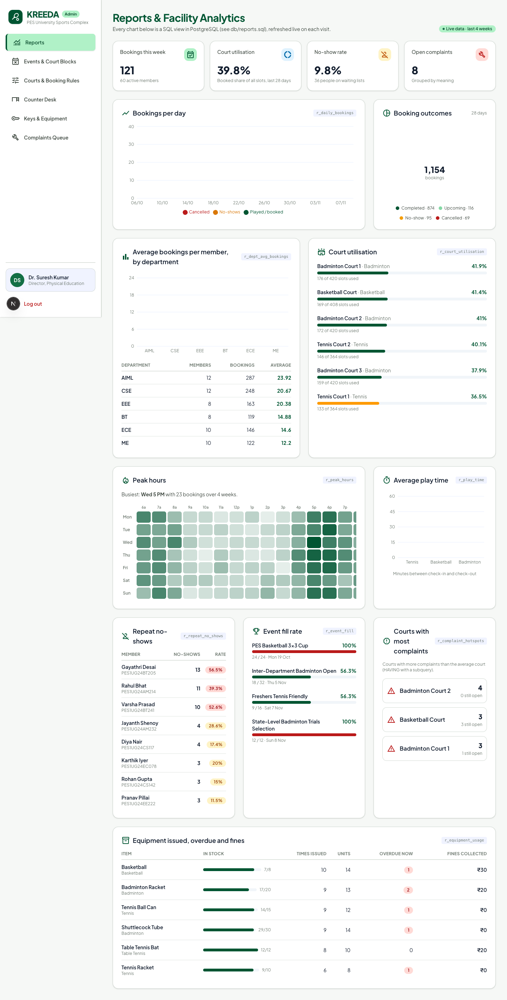
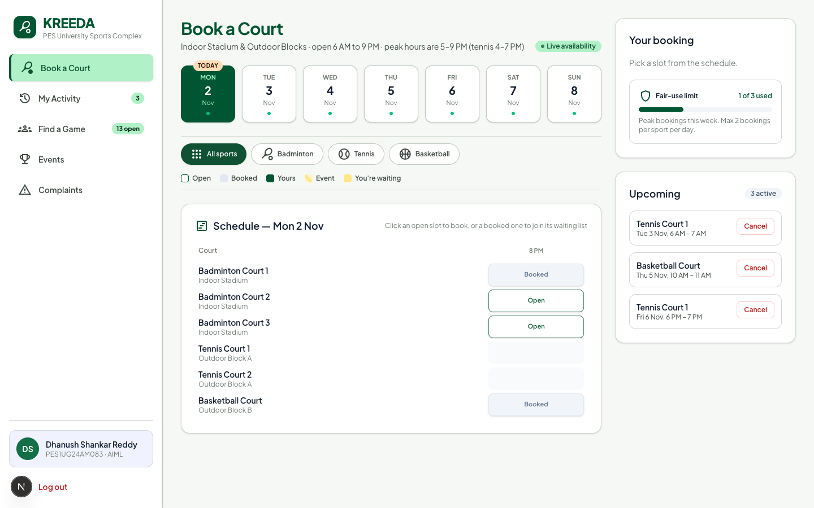
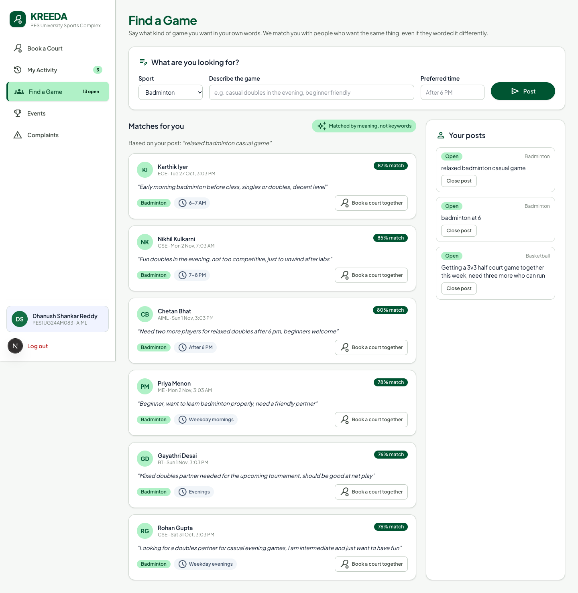
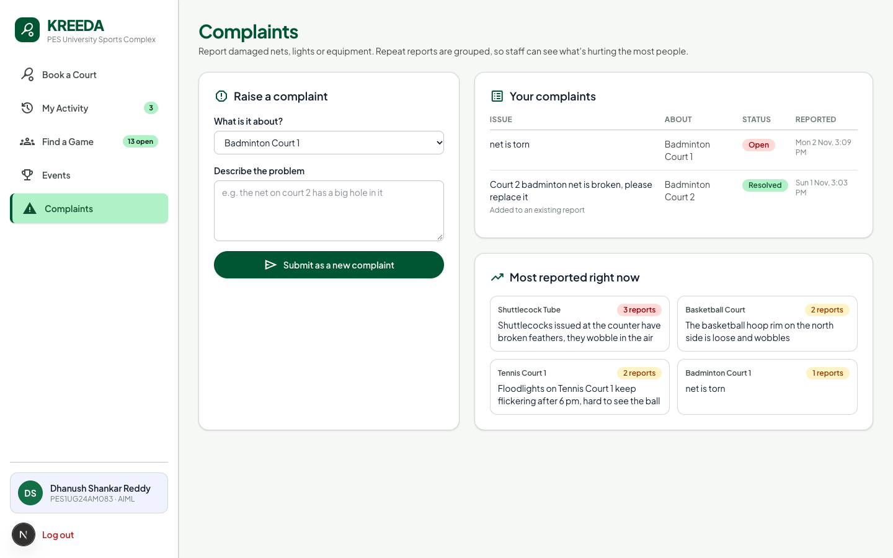
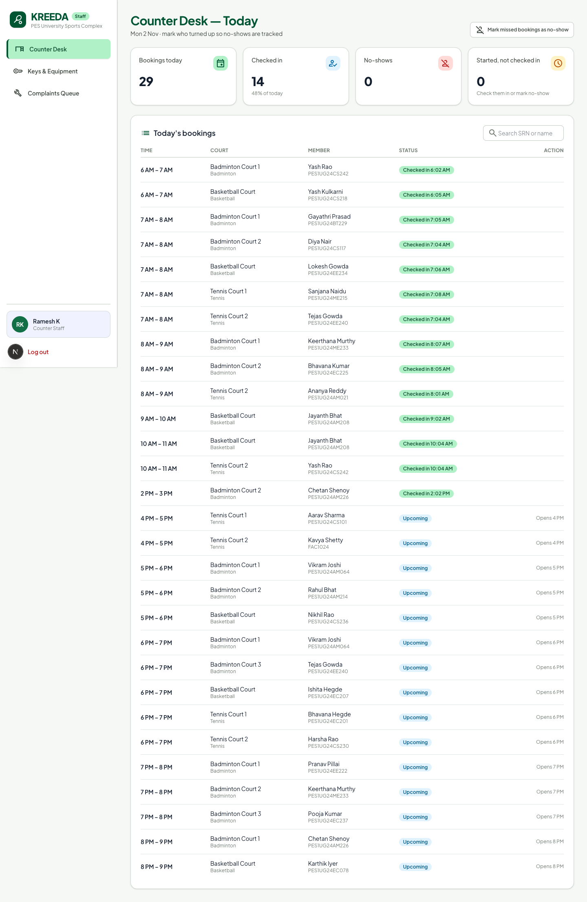

<div align="center">

# KREEDA

**Court booking, events and facility management for the PES University sports complex**

PostgreSQL + Qdrant (vector database) · Next.js 16 · DBMS Experiential Learning, Level 3

</div>



## Team

| Member | SRN |
|---|---|
| Dhanush Shankar Reddy | PES1UG24AM083 |
| Dhanush S S | PES1UG24AM082 |

## The problem

Courts at the PES sports complex are claimed informally at the counter. The same slot gets promised twice, courts sit empty when the person who claimed them doesn't show up, tournaments go on notice boards with no link to the courts they occupy, and damaged nets are reported by word of mouth and forgotten.

KREEDA moves all of this online and puts the rules inside the database, so they hold even when two people click "Book" at the same second.

## Features

| Role | Can do |
|---|---|
| **Member** | See live availability, book and cancel slots, join waiting lists, post "looking for a game" and get matched by meaning, register for events, raise complaints with automatic detection of similar existing ones |
| **Staff** | Check members in or mark no-shows, issue and return locker keys and equipment (late fines are calculated automatically), work through the complaints queue |
| **Admin** | Reports dashboard with charts, create events that block courts (clashing bookings are cancelled and members are told why), maintenance blocks, court timings and booking rules |

<table>
  <tr>
    <td></td>
    <td></td>
  </tr>
  <tr>
    <td align="center">Book a court</td>
    <td align="center">Find a game, matched by meaning</td>
  </tr>
  <tr>
    <td></td>
    <td></td>
  </tr>
  <tr>
    <td align="center">Complaints, grouped by similarity</td>
    <td align="center">Staff counter desk</td>
  </tr>
</table>

## Tech stack

| Layer | Technology |
|---|---|
| Frontend | Next.js 16 (App Router), React 19, Tailwind CSS v4, Recharts 3, UI designed in Google Stitch |
| Backend | Next.js server components and Server Actions (`app/actions/`) as the API layer, Node.js |
| Relational database | PostgreSQL 17 with PL/pgSQL functions, triggers, views, `pgcrypto` and `btree_gist` |
| Vector database | Qdrant (cosine similarity, payload filters) |
| Embeddings | `all-MiniLM-L6-v2` run locally with Transformers.js, so no API key or cost |
| Auth | bcrypt hashes checked inside PostgreSQL, HMAC-signed httpOnly session cookies |

## Databases (Option 2: SQL + vector database)

| Database | Holds | Why |
|---|---|---|
| **PostgreSQL** | Members, courts, slots, bookings, events, equipment, keys, complaints: 17 tables | The data is relational, and booking needs transactions and constraints. Only the database can guarantee one slot = one booking under simultaneous requests |
| **Qdrant** | Embeddings of game posts, complaints and event descriptions | This text is worded differently every time ("net torn on court 2" vs "badminton net sagging, court two"), so keyword search fails. Qdrant finds matches by meaning |

PostgreSQL is the single source of truth. Each Qdrant point uses the same id as its PostgreSQL row; search returns ids and the details are read from PostgreSQL. The vectors can be rebuilt at any time with `npm run index`.

### Why PostgreSQL over MySQL

- **Partial unique index:** `one_active_booking_per_slot ON booking (slot_id) WHERE status <> 'CANCELLED'` stops double booking in one line. MySQL has no partial indexes.
- **Exclusion constraint:** `EXCLUDE USING gist (court_id WITH =, tsrange(...) WITH &&)` makes overlapping court blocks impossible. MySQL has no equivalent.
- **pgcrypto** hashes passwords with bcrypt inside the database.

## Database design

ER diagram: [`docs/KREEDA_ER_Chen.drawio`](docs/KREEDA_ER_Chen.drawio) (Chen notation, open with [diagrams.net](https://app.diagrams.net)) and [`docs/KREEDA_ER.mmd`](docs/KREEDA_ER.mmd) (crow's foot, Mermaid).

**11 entities, 17 tables:** member, staff, app_user, court, slot, booking, waiting_list, attendance, event, event_registration, court_block, game_post, complaint, locker_key, key_issue, equipment, equipment_issue.

| Feature | Where (`db/schema.sql`) |
|---|---|
| Transactions and row locking | `book_slot()` locks the member row (`FOR UPDATE`) so fair-use limits hold under concurrent requests; an event and its court blocks are inserted in one transaction |
| Stored functions | `book_slot`, `cancel_booking`, `join_waitlist`, `mark_no_shows`, `generate_slots`, `is_peak` |
| Triggers | Slot status sync, **automatic waiting-list promotion** on cancel, court blocks cancel clashing bookings with a reason, attendance updates booking status, event capacity, equipment stock and late fines, key status |
| Constraints | PK/FK, UNIQUE, CHECK (phone format, time ranges, stock limits), partial unique indexes, an exclusion constraint |
| Views | `v_slot_board`, `v_todays_schedule`, `v_member_stats`, `v_open_complaints`, plus 10 report views |
| Indexes | B-tree, composite, partial, GiST |

### Reports (`db/reports.sql`)

Each report is a view, shown as a chart on the admin dashboard:

1. Average bookings per member by department
2. Court utilisation %
3. Peak hours heatmap (weekday × hour)
4. Repeat no-shows (`HAVING`)
5. Average play time per sport
6. Courts with more complaints than average (`HAVING` with a subquery)
7. Event fill rate
8. Equipment issued, overdue and fines
9. Bookings per day
10. KPIs

### Vector search

| Aspect | Choice |
|---|---|
| Embedded text | Game posts (sport + text + preferred time), complaints (court or item + text), events (name + sport + description) |
| Model | `all-MiniLM-L6-v2`, 384 dimensions |
| Collections | `game_posts`, `complaints`, `events`; point id = PostgreSQL primary key |
| Payload filters | game_posts: sport, is_open, member_id · complaints: status · events: sport |
| Retrieval | Filter on payload first (same sport, still open, not resolved, not your own post), then top-k by cosine similarity. Similar complaints are offered as "same problem" and linked with `duplicate_of` |

## Setup

### 1. Prerequisites

- **Node.js 20 or newer**
- **PostgreSQL 14 or newer** (17 recommended). `pgcrypto` and `btree_gist` ship with it.
- **A Qdrant cluster.** The free tier of [Qdrant Cloud](https://cloud.qdrant.io) is enough.

Installing PostgreSQL:

```bash
# macOS
brew install postgresql@17
brew services start postgresql@17

# Ubuntu / Debian
sudo apt install postgresql postgresql-contrib
sudo -u postgres createuser -s $USER
```

On Windows, use the installer from [postgresql.org](https://www.postgresql.org/download/windows/) and run the commands below in a terminal where `psql` is on the PATH.

### 2. Get a Qdrant cluster

1. Sign up at [cloud.qdrant.io](https://cloud.qdrant.io) and create a free cluster.
2. Copy the cluster URL (like `https://xxxx.cloud.qdrant.io:6333`).
3. Create an API key for it.

The collections are created automatically by `npm run index`.

### 3. Install and configure

```bash
git clone https://github.com/dhanush-sr/kreeda.git
cd kreeda
npm install
cp .env.example .env
```

Fill in `.env`:

| Variable | Value |
|---|---|
| `DATABASE_URL` | `postgres://localhost:5432/kreeda` (add `user:password@` if your PostgreSQL needs it) |
| `SESSION_SECRET` | Any long random string, e.g. the output of `openssl rand -hex 32` |
| `QDRANT_API_ENDPOINT` | Your cluster URL |
| `QDRANT_API_KEY` | Your Qdrant API key |

### 4. Create and load the database

```bash
createdb kreeda
npm run db:setup
```

This runs `db/schema.sql`, `db/seed.sql` and `db/reports.sql`: 17 tables, functions, triggers, views, and four weeks of sample data generated relative to today.

### 5. Build the vector index

```bash
npm run index
```

The first run downloads the embedding model (about 25 MB). After that it runs offline.

### 6. Run

```bash
npm run dev
```

Open http://localhost:3000.

### Demo logins

Password for every account: `kreeda123`

| Role | Username |
|---|---|
| Member | `PES1UG24AM083` (or any member SRN) |
| Staff | `STF101` |
| Admin | `ADM001` |

### Reset everything

```bash
npm run db:setup && npm run index
```

## Demo script

1. **Two people, one slot:** open two terminals with `psql -d kreeda`. In both, run `BEGIN; SELECT book_slot(<member>, <same open slot>);`. The second one waits on the lock; `COMMIT` the first and the second fails with `one_active_booking_per_slot`.
2. **Waiting list:** cancel a booking that has people waiting (My Activity → Cancel). The first person in line gets the slot automatically, done by a trigger.
3. **Event blocks:** Admin → Events & Court Blocks → create an event on some courts. Clashing bookings are cancelled and the affected members see the reason in My Activity.
4. **Search by meaning:** Complaints → type "the net on the second badminton court has a hole". The existing torn-net complaint shows up as similar. Events → search "beginner, just for fun".
5. **Reports:** Admin → Reports, or `\i db/reports.sql` in psql to see each query with its output.
6. **All tables:** `\i db/show_tables.sql` in psql.

## Project structure

```
app/            Pages: (member), staff, admin, login
app/actions/    Server Actions, the backend API layer
components/     UI components and charts
lib/            PostgreSQL pool, sessions, Qdrant client, embeddings
db/             schema.sql, seed.sql, reports.sql, show_tables.sql
scripts/        index-qdrant.js rebuilds the vector index from PostgreSQL
docs/           Requirements, synopsis, ER diagrams, screenshots
DESIGN.md       UI design system (colours, components, dashboard layout)
```

## Troubleshooting

| Problem | Fix |
|---|---|
| `extension "btree_gist" is not available` | Install the contrib package (`postgresql-contrib` on Linux) |
| `role "<you>" does not exist` | `sudo -u postgres createuser -s $USER`, or put the user in `DATABASE_URL` |
| `Qdrant 401` or `403` | Check `QDRANT_API_KEY` and that `QDRANT_API_ENDPOINT` has no trailing path |
| Similar complaints or game matches show nothing | Run `npm run index` after every `npm run db:setup` |
| Schedule looks empty after a few days | The sample data is relative to the day it was loaded. Run `npm run db:setup && npm run index` again |

## Security

- Passwords are stored as bcrypt hashes (`crypt()` from `pgcrypto`) and checked inside the database.
- Sessions are HMAC-signed, httpOnly cookies with a 12-hour expiry.
- Every page and server action checks the user's role on the server.
- All SQL is parameterised.
- Credentials live only in `.env`, which is git-ignored.
